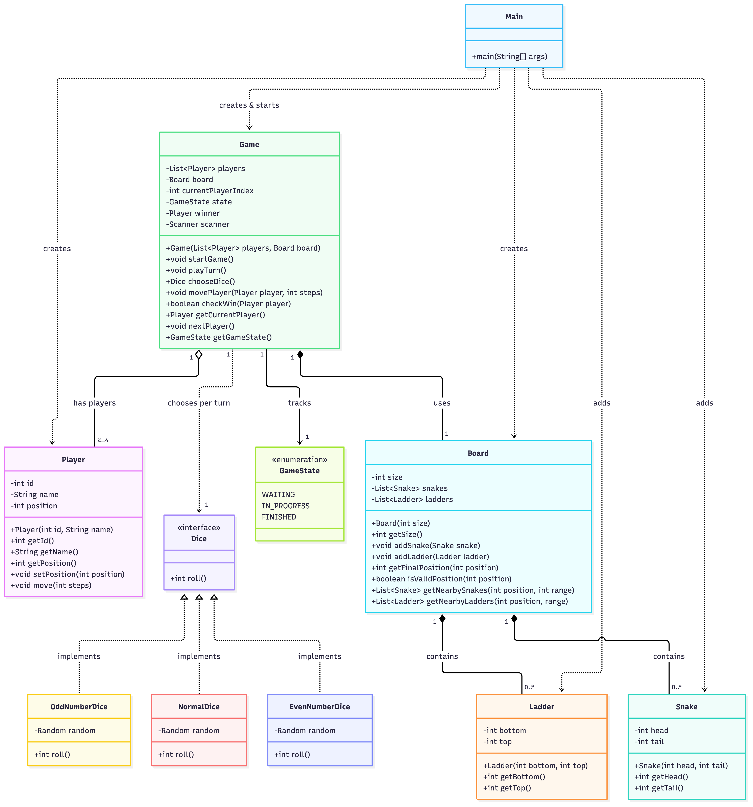
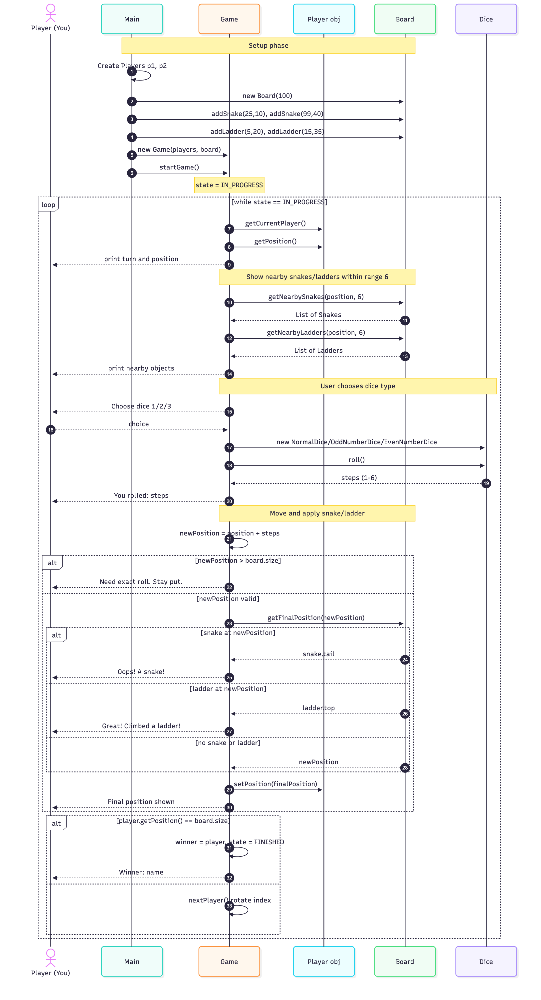

# 🐍 Snake and Ladder — Java LLD

A simple, well-structured implementation of the classic **Snakes and Ladders** board game in Java, built to practice Low-Level Design (LLD) principles: clean class separation, encapsulation, and the Strategy pattern for dice.

---

## 📌 Features

- 2 to 4 players per game (validated at runtime)
- 100-cell board with configurable snakes and ladders
- Three swappable dice strategies — pick one each turn:
  - **Normal Dice** → 1 to 6
  - **Odd Dice** → 1, 3, 5
  - **Even Dice** → 2, 4, 6
- Nearby snakes/ladders preview (within 6 cells) to help you choose the best dice
- Snake-bite and ladder-climb detection with messages
- Win condition: land **exactly** on cell 100 (overshooting keeps you put)
- Game state machine: `WAITING → IN_PROGRESS → FINISHED`

---

## 🗂️ Project Structure

```
SnakeAndLadder/
├── Main.java              # Entry point — builds the world and starts the game
├── Game.java              # Orchestrator: turn loop, dice choice, movement, win check
├── Board.java             # Holds snakes, ladders, and resolves final position
├── Player.java            # Player entity: id, name, position
├── Snake.java             # Snake entity: head (top) → tail (bottom)
├── Ladder.java            # Ladder entity: bottom → top
├── Dice.java              # Interface with roll()
├── NormalDice.java        # Implements Dice → 1-6
├── OddNumberDice.java     # Implements Dice → 1, 3, 5
├── EvenNumberDice.java    # Implements Dice → 2, 4, 6
├── GameState.java         # Enum: WAITING, IN_PROGRESS, FINISHED
├── uml_class_diagram.png  # UML class diagram
├── game_flow_sequence.png # Game flow sequence diagram
└── README.md
```

---

## 🧠 LLD Overview

The design is split into **four clean layers**:

### 1. Entities (the "things" on the board)
| Class | Role |
|-------|------|
| `Player` | Holds `id`, `name`, `position`. Knows how to `move(steps)`. |
| `Snake` | `head` bites you down to `tail`. Enforces `head > tail`. |
| `Ladder` | `bottom` climbs you up to `top`. Enforces `top > bottom`. |

### 2. Board (the container)
- Owns a `List<Snake>` and `List<Ladder>` (composition — they belong to the board).
- `getFinalPosition(position)` is the heart of the board: checks whether a snake head or ladder bottom sits at the given cell and returns the landing cell after applying it.
- `getNearbySnakes` / `getNearbyLadders` return obstacles within the next 6 cells so the player can choose a dice wisely.

### 3. Game (the orchestrator / brain)
- Holds `List<Player>`, one `Board`, the current player index, a `GameState`, and the winner.
- Loop: `startGame()` → while `IN_PROGRESS` → `playTurn()` per player → rotate.
- `movePlayer()` rolls the dice, computes the new cell, asks the board to apply snake/ladder, then updates the player's position.
- `checkWin()` sets the winner when a player reaches exactly `board.size`.

### 4. Dice (Strategy pattern)
- `Dice` is an interface with a single method `roll()`.
- `NormalDice`, `OddNumberDice`, `EvenNumberDice` all implement it.
- The game picks one per turn based on user input — the Strategy pattern in action.

---

## 📐 UML Class Diagram



### Relationship cheat sheet

| Arrow | Meaning |
|-------|---------|
| `Game ○—— Player` | Game **has** 2–4 players (aggregation — players exist outside the game) |
| `Game ◆—— Board` | Game **owns** one board (composition) |
| `Board ◆—— Snake / Ladder` | Board **owns** its snakes & ladders (composition — they die with the board) |
| `Game ——> Dice` | Game **depends on** Dice (creates one each turn) |
| `Dice <|.. NormalDice` etc. | The three dice classes **implement** the Dice interface |
| `Main ..> Game/Board/Player` | Main **creates** everything and starts the game |

---

## 🔁 Game Flow Sequence



**In plain words:**

1. `Main` builds the world: 2 players, a 100-cell board, adds 2 snakes and 2 ladders, then hands it all to `Game`.
2. `Game.startGame()` flips state to `IN_PROGRESS` and enters a loop.
3. Each turn:
   - Get current player → show position → show nearby snakes/ladders (within 6 cells).
   - Ask the user to pick a dice → roll → compute new cell.
   - Ask the board "any snake/ladder here?" → move player accordingly.
   - Check win → rotate to next player.
4. When a player lands exactly on cell 100, `checkWin()` sets the winner and the state to `FINISHED`, and the loop exits.

---

## 🎨 Design Patterns Used

- **Strategy Pattern** — `Dice` interface with three interchangeable implementations, chosen per turn.
- **Composition over Inheritance** — `Board` *contains* `Snake` and `Ladder` objects rather than extending them.
- **State Pattern (light)** — `GameState` enum drives the main loop (`WAITING → IN_PROGRESS → FINISHED`).
- **Encapsulation** — All fields are `private`; access goes through getters/setters. Snakes and ladders validate their inputs in the constructor (head > tail, top > bottom).

---

## ▶️ How to Run

You only need the JDK. No build tool required.

```bash
# Compile all Java files
javac *.java

# Run the game
java Main
```

Then follow the on-screen prompts to choose a dice each turn.

---

## 🎮 Sample Session

```
Welcome to Snakes and Ladders!

Dhanya's turn
Current position: 0
Nearby snakes:
  None
Nearby ladders:
  Ladder at 5 goes up to 20

Choose your dice:
1. Normal dice (1-6)
2. Odd dice (1, 3, 5)
3. Even dice (2, 4, 6)
Enter choice: 1
You rolled: 5
Great! You climbed a ladder!
Your final position: 20

Priya's turn
...
```

---

## 🚀 Possible Extensions

- Support for a crooked dice that always rolls 6 (another `Dice` implementation).
- Multiple snakes/ladders per cell or chained jumps.
- Undo / replay history.
- A GUI or web frontend.
- Persistent high scores.
